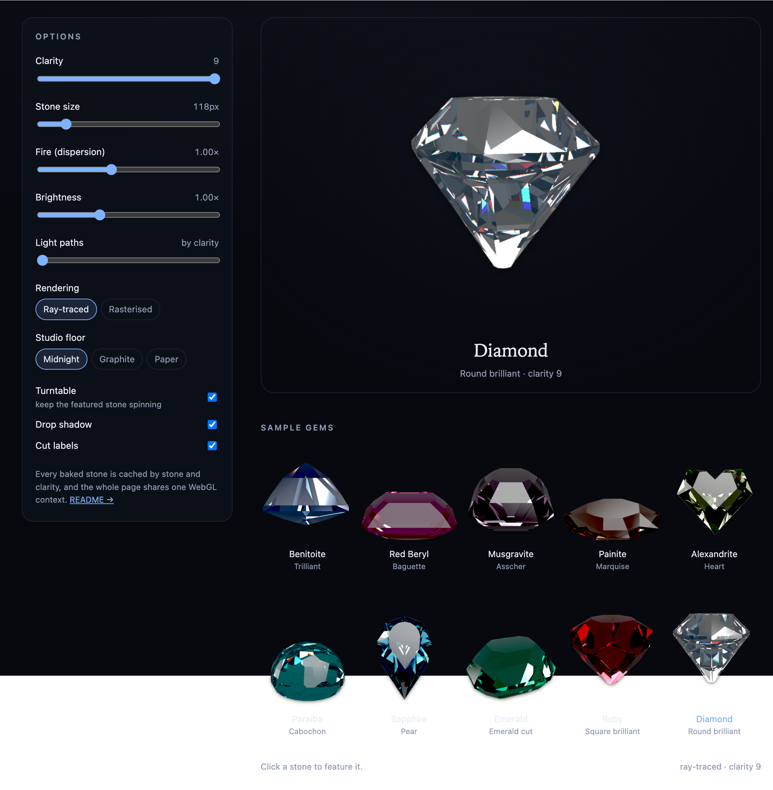

# gemrenderer

**Gemstones, cut the way they're meant to be. Ray-traced in the browser, with no frontend framework required.**

## Support

gemrenderer is free and MIT licensed. If you find it useful, you can support its development:

[](https://www.paypal.com/donate/?hosted_button_id=8GNAF6BQ7DACW)



gemrenderer renders gemstones by describing them in parts: a body colour, a cut, and a few optical constants. From there it builds the geometry and traces light through each facet. Fresnel reflection, refraction, total internal reflection and exit all come into play, with red, green and blue bending slightly differently to produce real chromatic fire. As light travels inside the stone, Beer–Lambert absorption deepens the colour based on the body colour, refractive index and dispersion.

The library doesn't hardcode any specific gemstone names. Instead, it ships a set of ready-made stones (benitoite, red beryl, musgravite, painite, alexandrite, paraíba, sapphire, emerald, ruby and diamond) as presets in [`gemrenderer/presets`](#presets). You can use them as-is, or define your own from scratch.

- **Works with or without a framework.** There's a vanilla DOM class, plus a small pure-function core and pointer gesture. You can also use it in Vue, React, Svelte or plain HTML/JS.
- **One WebGL context for the whole page.** Stones are baked once per (spec, clarity) and cached. Static images and live spinners share the same meshes, so nothing is wasted.
- **Falls back gracefully without WebGL.** If the browser can't create a WebGL context, it keeps a placeholder and your layout stays intact.
- **No assets, no build step.** Everything runs from plain ESM source with a small procedural HDR studio.
- **MIT licensed.**

## Demo

**[rubjo.github.io/gemrenderer](https://rubjo.github.io/gemrenderer/)** — Every preset on display, drag any of them to spin it. The options panel lets you tweak clarity, fire, brightness, light paths, rendering mode and the studio background.

## Install

```bash
npm install gemrenderer three
```

`three` is a peer dependency (`>=0.163`). Use the version your app already ships. gemrenderer loads three.js lazily, only when it actually needs to render.

```js
import { GemView } from 'gemrenderer'

// Define your own stone: a square-cut deep red brilliant
new GemView('#mount', {
  color: 0xa6001a,
  cut: { family: 'brilliant', poly: 4 },
  ior: 1.77,
  fire: 0.41,
  clarity: 8,
})

// Or use one of the built-in presets
import { gemSpec } from 'gemrenderer/presets'
new GemView('#mount', { ...gemSpec('ruby'), clarity: 8 })
```

That's it for most use cases. A placeholder appears first, then the baked stone replaces it. Once you drag it, it becomes a live canvas that spins freely in both directions and eases back to its resting position when you let go.
